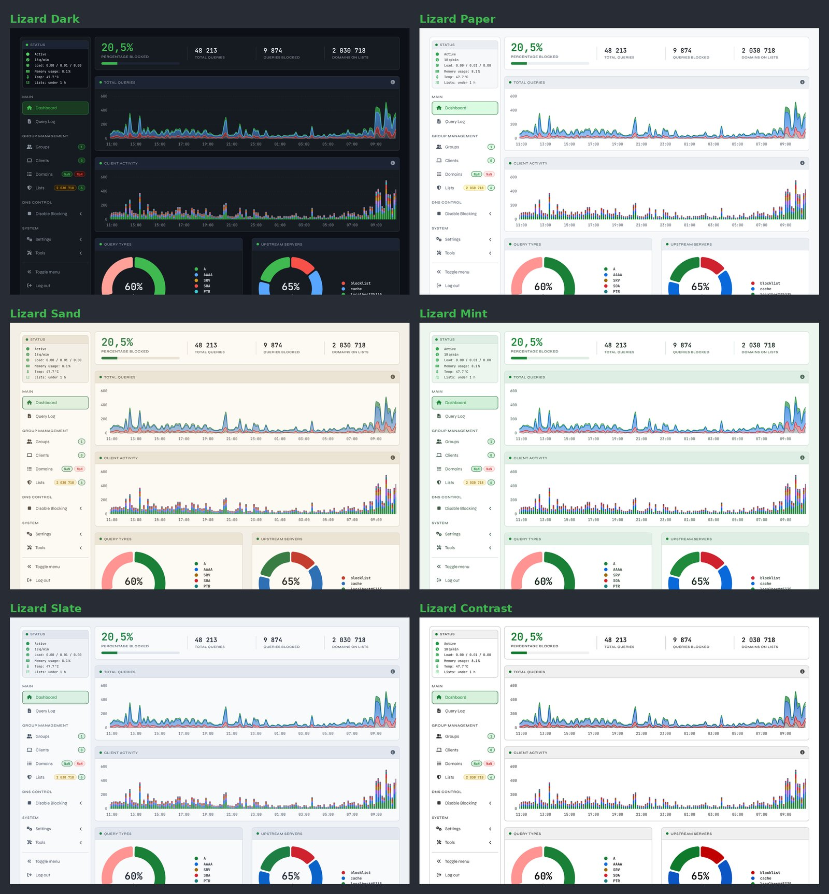

# pihole-lizard-theme

A dark theme for the Pi-hole v6 web interface (Syne + JetBrains Mono), with an installer
that survives Pi-hole updates.

**Version:** 1.2.1 · **Tested with:** pi-hole/web `master`, commit `fb699c4` (2026-10-17), Chart.js 4.5.1

Questions and feedback: [discussion on the Pi-hole forum](https://discourse.pi-hole.net/t/theme-pi-hole-lizard-theme/88412).

If you like this theme and want to say thanks, you can buy me a coffee:
[PayPal](https://www.paypal.com/paypalme/hbrtkp) · [buycoffee.to](https://buycoffee.to/hbrtkp)




## What you get

- dark panel with boxes, a status panel with CPU temperature and blocklist age,
- dashboard statistics in one box, smooth charts,
- no top bar and no footer: "Toggle menu", "Log out" and the Pi-hole versions live at the
  bottom of the sidebar,
- a Dark / Light switch at the bottom of the sidebar; the light side uses one of five
  palettes — paper (default), sand, mint, slate, contrast,
- the theme comes back by itself after the Sunday Pi-hole update and after a reboot.

Nothing about DNS, blocking or security is touched — the theme only changes the look of
`http://pi.hole/admin`.

## Install

On the Pi (`git` is needed once: `sudo apt install -y git`):

```bash
git clone https://github.com/hbrtkp/pihole-lizard-theme.git
sudo bash ~/pihole-lizard-theme/pihole-theme.sh install
```

Then `Ctrl+F5` in the browser on `http://pi.hole/admin`.

## Check

```bash
sudo pihole-theme doctor
```

The last line must read `Result: errors=0, warnings=...`. Lines marked `[FAIL]` say what to
do. Run it whenever the panel looks wrong, e.g. after a Pi-hole update.

If the panel still looks stock after an update you started by hand (`pihole -up`):

```bash
sudo pihole-theme reapply
```

## Light palette

The switch remembers the choice per browser. Which light palette it uses is set once
on the Pi:

```bash
sudo pihole-theme set light sand      # paper | sand | mint | slate | contrast
```

## Update the theme

```bash
cd ~/pihole-lizard-theme && git pull
sudo bash pihole-theme.sh install
sudo pihole-theme doctor
```

## Uninstall

```bash
sudo pihole-theme restore          # original Pi-hole look, cron job and command removed
sudo rm -rf /opt/pihole-theme ~/pihole-lizard-theme   # files and settings, downloaded copy
```

Then `Ctrl+F5` in the browser. The system is back to the state before the installation.

## License

Theme code (CSS, JS, installer) — [MIT](LICENSE).

The [Syne](https://fonts.google.com/specimen/Syne) and
[JetBrains Mono](https://fonts.google.com/specimen/JetBrains+Mono) fonts are licensed under the
[SIL Open Font License 1.1](https://openfontlicense.org/) and are not covered by the MIT license.
