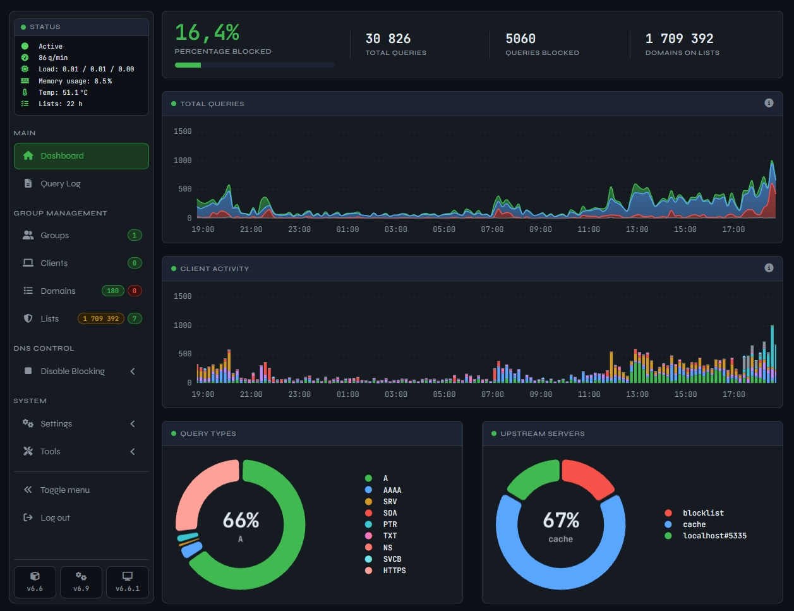

# pihole-lizard-theme

Dark "Lizard" theme for the Pi-hole v6 web interface, with an installer that survives Pi-hole updates.

Created for use with [Pi-hole](https://github.com/pi-hole/pi-hole) v6.



---

## Compatibility

- **Pi-hole v6 only.** The theme takes over the slot of the built-in "High contrast dark" theme, which exists only in v6. It does not work with Pi-hole v5.
- Tested with `pi-hole/web` master, commit `fb699c4` (2026-10-17), Chart.js 4.5.1, on a Raspberry Pi 4B running Raspberry Pi OS.
- Themed dropdowns need Chrome or Edge 135+; in other browsers they stay native. Everything else works in any modern browser.
- Run `sudo pihole-theme doctor` after a Pi-hole update to confirm the theme still fits the installed version (see below).

## Install

Type the following commands into SSH, line by line.

```
cd ~
git clone https://github.com/hbrtkp/pihole-lizard-theme.git
sudo bash ~/pihole-lizard-theme/pihole-theme.sh install
```

Then reload the web interface bypassing the cache (`Ctrl+F5`). The installer:

- copies the theme files to `/opt/pihole-theme` and puts the theme into the "High contrast dark" slot,
- switches Pi-hole to that theme (`webserver.interface.theme`),
- registers the `pihole-theme` command,
- adds a cron job (`/etc/cron.d/pihole-theme`) that re-applies the theme after a Pi-hole update and after boot, and collects the server status for the sidebar every minute.

## Update

```
cd ~/pihole-lizard-theme
git pull
sudo bash pihole-theme.sh install
```

Your settings (layout, accent, brand, status lines, mail) are kept.

After a manual Pi-hole update (`pihole -up`) the stock files come back; run `sudo pihole-theme reapply` (the Sunday cron job does this on its own).

## Uninstall / Revert

```
sudo pihole-theme restore
```

This puts the original "High contrast dark" file back, removes the add-on line from the footer template, the fonts, the cron job and the `pihole-theme` command, and sets the Pi-hole theme to `default-auto`. Reload with `Ctrl+F5`.

The package files and your settings stay in `/opt/pihole-theme` so you can reinstall later. To remove everything:

```
sudo rm -rf /opt/pihole-theme ~/pihole-lizard-theme
```

## Theme doctor

```
sudo pihole-theme doctor
```

`doctor` is a compatibility check against the Pi-hole version that is actually installed. It reports each check as `[OK]`, `[WARN]` or `[FAIL]` and ends with a summary line (`Result: errors=N, warnings=M`). It checks that:

- the theme sits in its slot and matches the current settings,
- FTL has the theme selected,
- the Pi-hole templates still have the hooks the theme relies on (`header.lp`, `sidebar.lp`, `footer.lp`),
- the add-on script is attached and deployed,
- the dashboard charts and the chart palette in Pi-hole's JavaScript still have the identifiers the chart skin expects, and Chart.js is version 4,
- a CPU temperature sensor is visible and the server status file is fresh,
- the re-apply cron job exists.

`[WARN]` means a part of the add-ons may not show (e.g. no temperature sensor); the theme itself still works. `[FAIL]` means something needs your attention — the message says what to run, usually `sudo pihole-theme reapply`.

The cron job runs `doctor` after every re-apply. If it reports an error — for example a new Pi-hole version changed the files the theme relies on — a mail with the full result is sent to `root` (via the `mail` command, e.g. msmtp). No mail is sent when everything is fine. Test the delivery with `sudo pihole-theme mail test`; disable with `sudo pihole-theme mail off`.

## Commands

| Command | Effect |
|---|---|
| `sudo pihole-theme layout islands\|joined` | separate cards (default) / joined panels |
| `sudo pihole-theme set accent '#rrggbb'` | accent colour (in quotes) |
| `sudo pihole-theme set gap N` / `set radius N` | card spacing and corner radius in px (*islands* layout) |
| `sudo pihole-theme set reset` | back to the default parameters |
| `sudo pihole-theme brand "Name"` / `brand off` | text shown instead of "Pi-hole" (login page, phone) |
| `sudo pihole-theme status-lines <lines>` | server status lines under the temperature: `clock resolver lists bans power` / `all` / `none` / `default` |
| `sudo pihole-theme addons on\|off` | charts, favicon, temperature, server status, sidebar tools |
| `sudo pihole-theme mail test` / `<address>` / `off` / `default` | notification recipient (default `root`) |
| `sudo pihole-theme reapply` | re-apply the theme (after a manual `pihole -up`) |
| `sudo pihole-theme status` | current settings |
| `sudo pihole-theme doctor` | compatibility check |
| `sudo pihole-theme version` | package version |
| `sudo pihole-theme restore` | back to the stock interface |

## What the theme does

- boxes with a title bar and a green dot; dashboard statistics in one wide box (blocked percentage with a bar, three counters next to it),
- no top bar and no footer: "Toggle menu", "Log out" and the Pi-hole version tiles live at the bottom of the sidebar (an amber tile means an update is available),
- sidebar pinned to the top with the same height on every page; when an expanded submenu does not fit, only the menu list scrolls,
- status panel with CPU temperature and blocklist age,
- charts: "Total queries" as a smooth area, "Client activity" as rounded bars, doughnuts with the value in the middle,
- tail log: every blocked line highlighted, including the kinds Pi-hole does not colour itself,
- no "Donate" entry; login page without the Documentation / GitHub / Discourse buttons.

Fonts: Syne and JetBrains Mono, bundled as `.woff2`.

## Limitations

- The top bar stays on phones (below 768 px), in the `joined` layout and with `addons off` — without it you could not open the menu or log out there.
- `set accent` changes the accent green; the chart palettes stay unchanged.
- Charts on pages other than the dashboard stay stock.

---

### License

This project is licensed under the MIT License - see the [LICENSE](LICENSE) file for details.

The [Syne](https://fonts.google.com/specimen/Syne) and [JetBrains Mono](https://fonts.google.com/specimen/JetBrains+Mono) fonts are licensed under the [SIL Open Font License 1.1](https://openfontlicense.org/) and are not covered by the MIT license.
